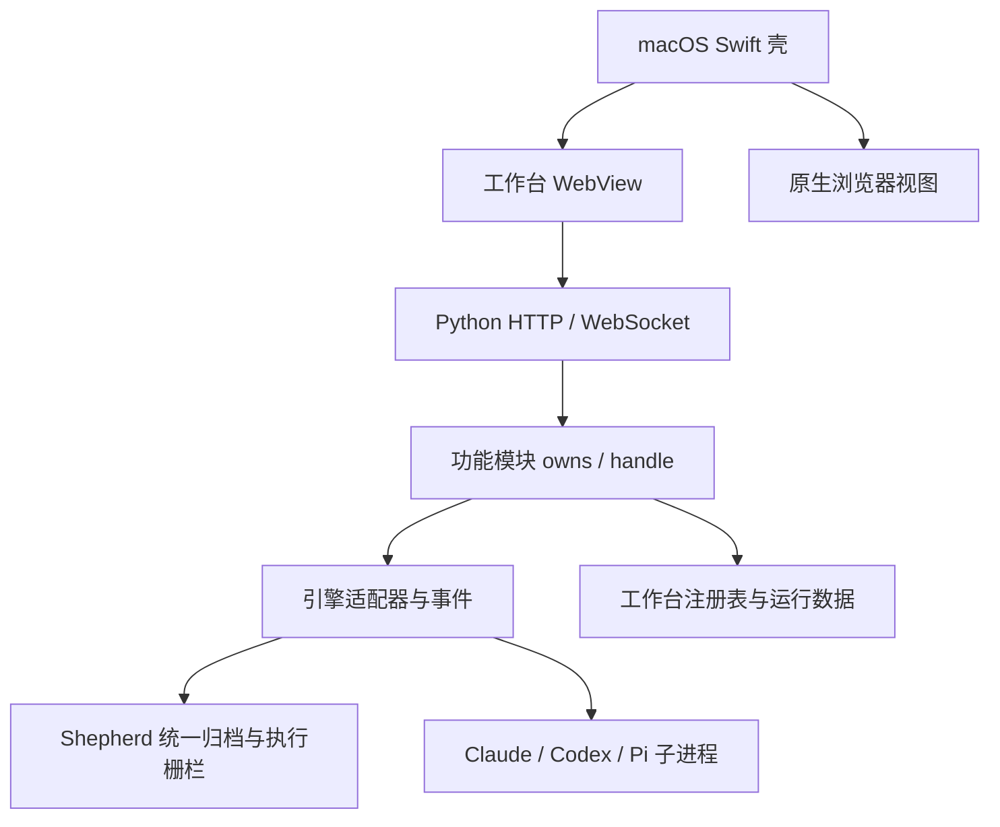

# 运行架构

当前 Desk 由桌面壳、网页界面和 Python 服务组成，引擎通过适配器接入。后端包含完整的会话、任务、应用、记忆与 Bot 实现。

## 启动与路由

[启动器](../desktron/bin/desktron)准备工作目录和环境，[ui_server.py](../desktron/lib/ui_server.py)装配 HTTP、静态资源和 WebSocket 处理，[ui_boot.py](../desktron/lib/ui_boot.py)登记各域 API。域模块通过 `owns(path, method)` 声明路由，再由 `handle` 处理请求。

首屏聚合复用真实域处理器，不另存一套业务快照，会话扫描等慢操作也不全部阻塞首屏。配置常量集中在 [deskcfg.py](../desktron/lib/deskcfg.py)，它依赖启动参数，因此测试导入时必须提供合法 argv。

系统提示由表达约束、工作环境、红线、判断原则、工作流原则、文档导航、首轮场景和引擎增量共同构成。`grounding` 只负责其中的 Desk 稳定约定与场景快照。各引擎和 Shepherd 使用不同投递载体，不能把某个适配器中的字符串当作完整 system prompt。文档导航从目录页生成，提供实际读取路径；开发入口只对关联 Desk 源码的工作流提供。详见 [System Prompt 装配与治理](system-prompt.md)。

Shepherd 三引擎共用统一归档、来源验证和恢复栅栏，原生常驻 Host 只是可丢弃的执行缓存。普通会话仍使用各引擎原生历史。详见 [Shepherd](shepherd.md)。

## 进程与数据

[engine.py](../desktron/lib/engine.py)管理引擎适配器实例。终端、Bot、调度和记忆维护各有自己的生命周期。主进程退出会影响这些工作，因此不能把关闭窗口、终止子进程和完成任务混为同一状态。

运行数据的位置与归属见[数据归属](runtime-data.md)。配置 `DESKTRON_REMOTE_TOKEN` 后，服务才对本机以外的网卡开放，并要求共享令牌鉴权；未配置时只绑定环回地址。`DESKTRON_SERVE_PORT` 另开一个仅环回的 Tailscale Serve 入口，该端口上的环回来源视为转发代理，每个请求都需要验证令牌，不享受本机放行（[remote_auth.py](../desktron/lib/remote_auth.py)）。

macOS 使用 Swift 原生壳，Windows 使用 `desktop/windows` 下的 Rust 壳（WebView2），两者遵守同一套 Supervisor 与前端桥契约，见 [Windows 版](windows.md)。`desktop/` 根下的 Tauri 文件是备用骨架，不作为产品架构。Swift 壳同时是 Python 后端的唯一 Supervisor：每次拉起后端时分配独立 generation，通过精确 child 身份和 `/desk-probe` 四元事实判断健康状态。计划重启与异常退出走同一串行状态机，连续失败时退避并显式报错。嵌入式浏览器层级由原生与前端共同管理，见[界面与交互](ui-architecture.md)。
